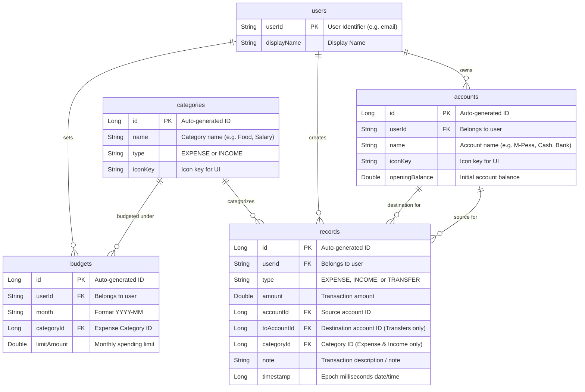
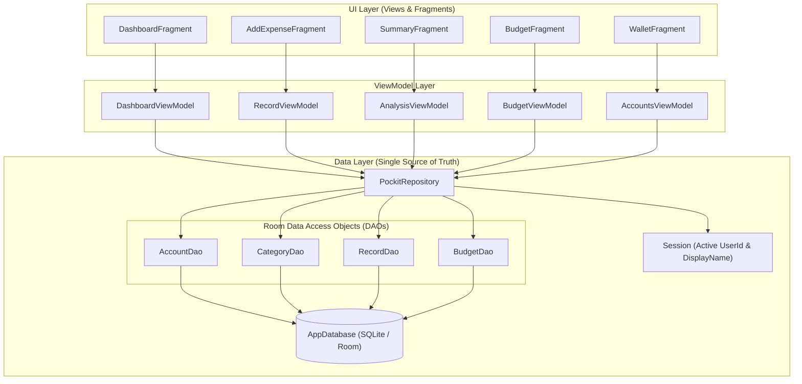
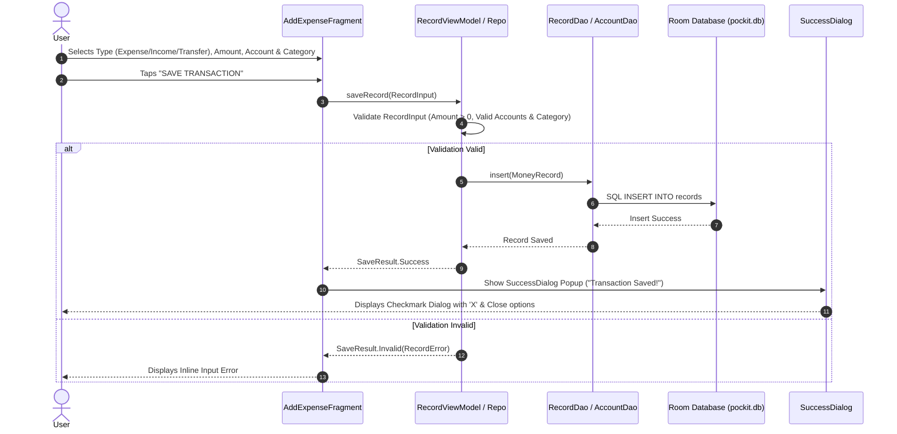

# Pockit App - System & Data Architecture Diagrams

This document contains the Entity-Relationship Diagram (ERD), Architecture Diagram, and Data Flow Diagrams for the Pockit Personal Finance Android application.

---

## 1. Entity-Relationship Diagram (ERD)

---

## 2. System Architecture Diagram

---

## 3. Data Flow Diagram (DFD)

